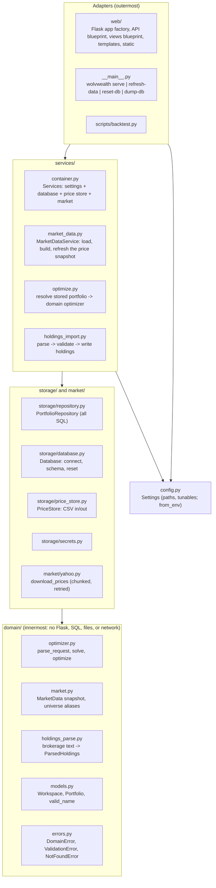
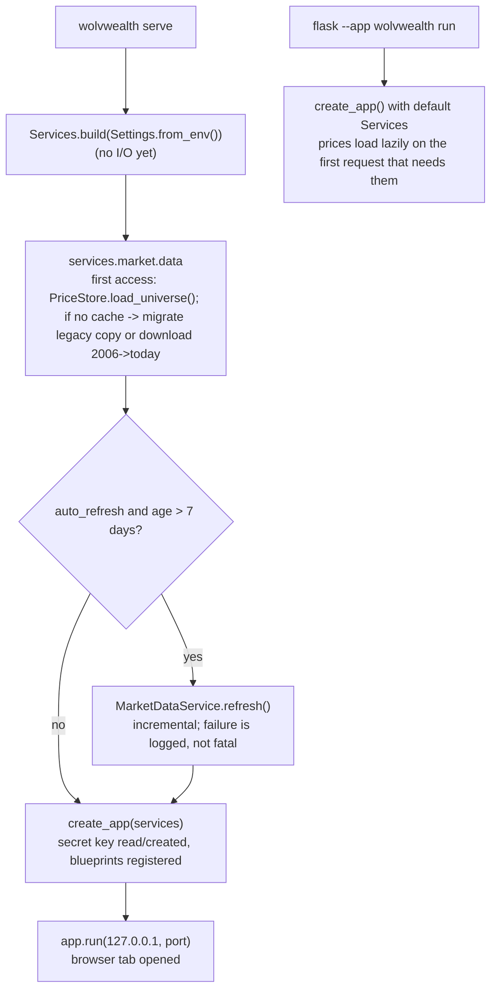
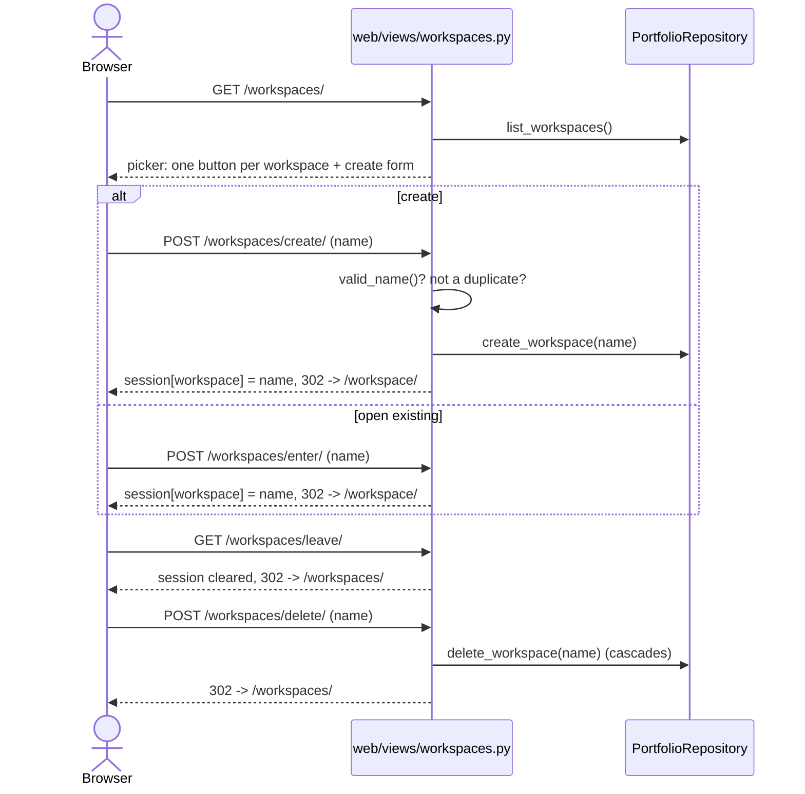
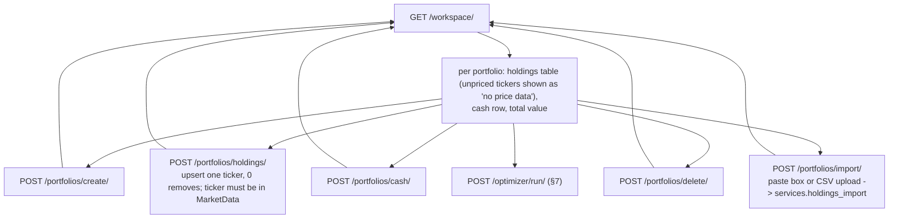
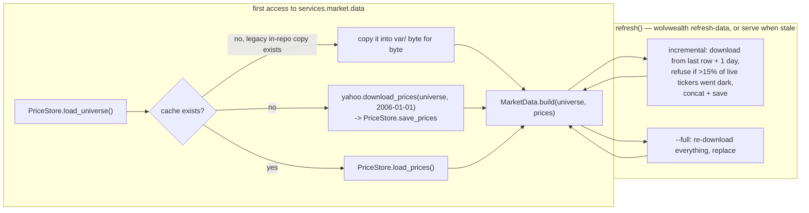
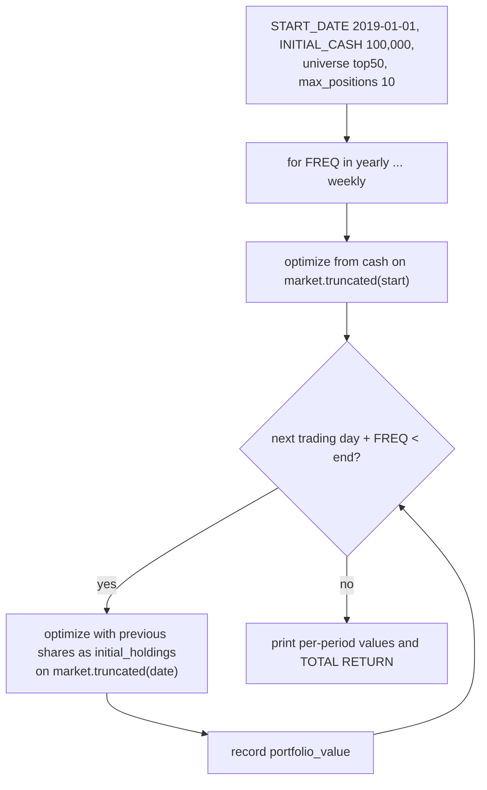
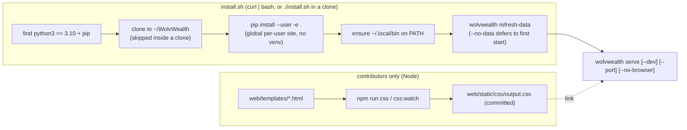
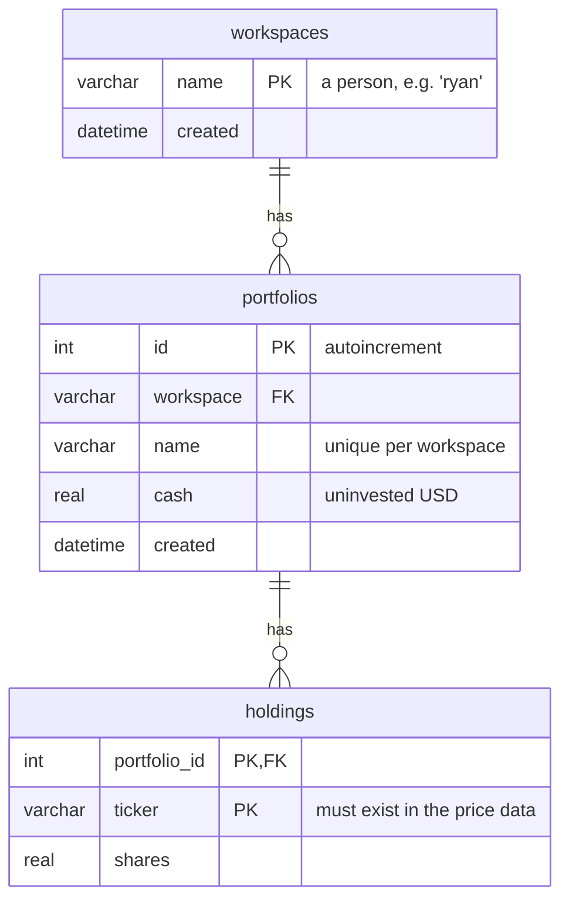

# WolvWealth architecture

This is the map of the code as it is today. It is written for someone who wants to change or extend the app: what the layers are, which direction dependencies point, how a request flows through, and where a new feature plugs in. The project goals and status are in [README.md](README.md); the ordered to-do list is in [MIGRATION.md](MIGRATION.md).

> **October 2026:** the old online-auth system (accounts, passwords, API keys, paid tiers, admin endpoints) has been removed and replaced with local **workspaces**, and the package has been restructured into layers. If you remember `ApplicationState`, `wolvwealth/api/`, or `wolvwealth/views/`, they are gone; the equivalents are mapped in §3.

## 1. What it is

WolvWealth is a single-process Flask web application for local use. Given a cash amount and/or a set of current stock holdings, it uses [PyPortfolioOpt](https://pyportfolioopt.readthedocs.io/) to compute a maximum-Sharpe-ratio portfolio over a universe of US equities and ETFs, and returns target weights, share counts, and dollar values.

The organizing concept is the **workspace**: one person using this machine (e.g. `ryan`, `my-brother`). Each workspace holds any number of named **portfolios** (e.g. `long-term`, `short-term`), and each portfolio is a cash balance plus share counts per ticker. There are no passwords; anyone at the keyboard can open any workspace. Separation is for organization, not security.

| Piece | Where | Status |
|---|---|---|
| Server-rendered website (landing, workspace picker, workspace page with portfolio CRUD and bulk import, optimizer results) | `wolvwealth/web/views/`, `wolvwealth/web/templates/` | Working end to end |
| JSON API (optimize, list workspaces, bulk-import holdings) | `wolvwealth/web/api/` | Working, no auth required |
| `wolvwealth` command (serve, refresh-data, reset-db, dump-db) and `install.sh` | `wolvwealth/__main__.py`, `install.sh` | Working |
| Market data (ticker list + ~20 years of daily adjusted closes) | `wolvwealth/data/ticker_universe.csv` (in the package), `var/historical_prices.csv` (local cache) | Loaded on first access; refreshed by `wolvwealth serve` when stale or by `wolvwealth refresh-data` |
| Walk-forward backtest | `scripts/backtest.py` | Standalone, reuses the domain optimizer |

## 2. The layers and the dependency rule

The package is organized as concentric layers. **A module may import only from its own layer or layers inside it.** `tests/test_architecture.py` parses every file's imports and fails if that rule is broken, so the diagram below is enforced, not aspirational.



What each layer is allowed to know:

| Layer | May import | Must not know about |
|---|---|---|
| `domain/` | numpy, pandas, PyPortfolioOpt, itself | Flask, SQLite, file paths, yfinance, HTTP status codes |
| `storage/`, `market/` | `domain` | Flask, each other |
| `services/` | `domain`, `storage`, `market`, `config` | Flask, `request`, `session`, `g` |
| `web/`, `__main__.py` | everything above | SQL text, solver calls (they call services) |

Why this shape matters for extensibility: a new feature is a new function in `services/` that takes a repository and a `MarketData` and returns plain data, plus whatever thin adapter exposes it (a route, a CLI subcommand). It cannot accidentally reach into Flask internals, the maths cannot accidentally depend on the database, and everything in `domain/` and `services/` is testable without a server. See §12 for the recipe.

Everything resolves paths from `Settings` in `config.py` (absolute, derived from the package location), so the app, the API, and the `wolvwealth` command can be started from **any** working directory.

## 3. Repository layout

```
.
├── wolvwealth/                    The package. Importing it has no side effects.
│   ├── __init__.py                Exports create_app (so `flask --app wolvwealth run` works)
│   ├── __main__.py                The `wolvwealth` command
│   ├── config.py                  Settings dataclass; Settings.from_env() reads WOLVWEALTH_VAR / WOLVWEALTH_NO_AUTO_REFRESH
│   ├── domain/
│   │   ├── errors.py              DomainError(message, details) + ValidationError, NotFoundError
│   │   ├── models.py              Workspace, Portfolio dataclasses; valid_name()
│   │   ├── market.py              MarketData(universe, prices): price(), value(), top(n), truncated(), expand_universe()
│   │   ├── optimizer.py           parse_request() -> OptimizationRequest; solve(); optimize()
│   │   └── holdings_parse.py      parse_holdings(text, universe) -> ParsedHoldings (pasted lines, brokerage CSVs)
│   ├── storage/
│   │   ├── database.py            Database(path): open(), connect() (transaction), ensure_schema(), reset()
│   │   ├── repository.py          PortfolioRepository(connection): every query on the three tables
│   │   ├── price_store.py         PriceStore: load/save prices CSV and the ticker list; legacy migration
│   │   ├── secrets.py             load_or_create_secret_key()
│   │   └── sql/schema.sql, data.sql   Three tables + the `demo` seed
│   ├── market/
│   │   └── yahoo.py               download_prices(tickers, start, end): chunked, paused, retried
│   ├── services/
│   │   ├── container.py           Services.build(settings) wires everything; Services.repository(conn)
│   │   ├── market_data.py         MarketDataService: lazy load / first-run build / refresh / auto_refresh_if_stale
│   │   ├── optimize.py            optimize(payload, market, repo, default_workspace); payload_for_portfolio()
│   │   └── holdings_import.py     import_holdings(...) -> ImportOutcome; resolve_target(); parse_holdings_map()
│   ├── web/
│   │   ├── __init__.py            create_app(services) -> Flask
│   │   ├── context.py             services(), repo(), market(), current_workspace(); per-request connection
│   │   ├── api/__init__.py        Blueprint "api" at /api: /, /workspaces/, /optimize/, /holdings/import/; DomainError -> JSON
│   │   ├── views/                 Blueprint "views": index, workspaces, portfolios (incl. import), optimizer
│   │   ├── templates/             Jinja, all extending base.html
│   │   └── static/                logo + hero image, util.css, committed Tailwind build (output.css)
│   └── data/ticker_universe.csv   One ticker per line, descending market cap
├── scripts/backtest.py            Standalone walk-forward backtest
├── tests/                         pytest; conftest builds Services on a temp dir with a 4-ticker synthetic market
├── install.sh                     One-command installer (also curl-able)
├── pyproject.toml                 Metadata, four runtime deps, `wolvwealth` entry point, package data, lint settings
├── package.json, tailwind.config.js   Dev-only: `npm run css` rebuilds the committed CSS
├── var/                           Local state, gitignored: wolvwealth.sqlite3, secret_key, historical_prices.csv
└── README.md, CONTRIBUTING.md, ARCHITECTURE.md, MIGRATION.md
```

Where the old names went: `ApplicationState` → `MarketData` (the snapshot) + `MarketDataService` (loading/refresh) + `market/yahoo.py` (networking); `api/optimize.py`'s `Optimization` class → `domain/optimizer.py` functions; `InvalidUsage` → `domain/errors.py`; `portfolios.py` + `model.py` → `storage/repository.py` + `storage/database.py`; `views/` → `web/views/`; `api/` → `web/api/`.

## 4. Process startup



`import wolvwealth` does nothing but define things. `Services.build()` wires collaborators without touching disk. The database file is created from `storage/sql/` the first time a connection is opened; the price cache is created the first time `services.market.data` is read. Only `wolvwealth serve` refreshes prices at startup.

## 5. Workflow: workspaces

The session cookie stores exactly one thing: the name of the open workspace. `web/context.py: current_workspace()` reads it and drops it if the workspace has been deleted in the meantime.



Validation errors surface as flashed messages on the picker. Old URLs from the account era redirect: `/login/` and `/register/` go to `/workspaces/`, `/account/` goes to `/workspace/`.

## 6. Workflow: portfolios of a workspace

`GET /workspace/` is the main page: every portfolio in the open workspace with holdings valued at the last cached price, plus forms for every mutation. Every POST redirects back to `/workspace/` and reports problems via flashed messages.



**Bulk import.** The view reads the pasted text or uploaded file and calls `services.holdings_import.import_holdings(repo, market, portfolio, text=..., mode=..., skip_unknown=...)`. That service runs `domain.holdings_parse.parse_holdings()`, which accepts `TICKER, shares` lines with any common separator, or a CSV with a header row where the symbol and share columns are found by name (`symbol`/`ticker`, `quantity`/`shares`/`qty`), so brokerage position exports work unmodified; extra columns, blank lines, `#` comments, and summary rows are ignored, duplicate lots are summed, and a `CASH` row sets cash. Tickers must be in the universe; unknown ones block the import unless skipped. Writes are all-or-nothing: the service raises `ValidationError` with every problem in `details` and nothing is written; the view turns `details` into one flash.

Every repository query is scoped by `(workspace, portfolio_id)`, so a stale or guessed form value cannot touch another workspace's portfolio.

## 7. Workflow: optimize a portfolio (the core feature)

The maths is `domain/optimizer.py`: `parse_request(payload, market)` validates a plain dict into an `OptimizationRequest`, `solve(request, market)` runs PyPortfolioOpt and returns the result dict, `optimize()` does both. The only inputs are the dict and a `MarketData`, so the same code runs from the browser, the API, tests, and the backtest.

```mermaid
sequenceDiagram
    actor B as Browser
    actor C as API client
    participant V as web/views/optimizer.py
    participant A as web/api (POST /api/optimize/)
    participant S as services/optimize.py
    participant R as PortfolioRepository
    participant D as domain/optimizer.py
    participant PF as PyPortfolioOpt

    B->>V: form: portfolio_id, universe alias, constraints
    V->>R: get_portfolio(workspace from session, id)
    V->>S: payload_for_portfolio(portfolio, alias, ...)<br/>(held tickers join the universe so they may be kept)
    V->>S: optimize(payload, market)

    C->>A: JSON body
    A->>S: optimize(body, market, repo, default_workspace=session)
    S->>S: resolve_portfolio_reference(): "portfolio" -> stored cash/holdings<br/>(explicit fields win)
    S->>R: get_portfolio(workspace, name) [NotFoundError if missing]

    S->>D: optimize(payload, market)
    D->>D: parse_request: validate every field (ValidationError)
    D->>D: total = cash + market.value(holdings); 0 -> ValidationError
    D->>PF: mean_historical_return, exp_cov over market.prices[universe]
    D->>PF: EfficientFrontier.max_sharpe (+ max_weight constraint)
    PF-->>D: weights -> clean, truncate to max_positions, renormalize
    D-->>S: result dict (metrics describe the truncated portfolio)
    S-->>A: 200 JSON
    S-->>V: render results.html
    Note over A,V: ValidationError -> 400 JSON / NotFoundError -> 404 JSON (API)<br/>DomainError -> flashed message on /workspace/ (browser)
```

The `max_positions` step is a post-hoc truncation, not a cardinality constraint in the solver. The reported Sharpe/return/volatility metrics are recomputed from the truncated, renormalized weights, so they describe the portfolio that is actually returned.

### API request schema

All fields are optional. Unknown fields are ignored.

```json
{
  "workspace": "ryan",
  "portfolio": "long-term",
  "initial_cash": 10000,
  "initial_holdings": { "AAPL": 10, "MSFT": 5.5 },
  "universe": ["top50", "TSLA"],
  "constraints": { "max_weight": 0.25, "max_positions": 10, "min_universal_weight": 0.0 },
  "exclude_metrics": false
}
```

| Field | Meaning | Default |
|---|---|---|
| `workspace` + `portfolio` | Load `initial_cash` and `initial_holdings` from this stored portfolio. `workspace` falls back to the browser session's open workspace. Explicit `initial_cash`/`initial_holdings` in the same request win over the stored values | not used |
| `initial_cash` | Cash to invest, USD | 0 (or the stored portfolio's cash) |
| `initial_holdings` | Ticker to share count, valued at the **last row of the price cache** and pooled with cash | `{}` (or the stored holdings) |
| `universe` | Tickers to allocate across. Aliases `top20` ... `top500` expand to the first N tickers of the universe | top 500 by market cap |
| `constraints.max_weight` | Per-asset cap, 0 to 1 | 1 |
| `constraints.max_positions` | Keep only the N largest weights after solving, then renormalize | unlimited |
| `constraints.min_universal_weight` | Lower bound applied to **every** asset in the universe | 0 |
| `exclude_metrics` | Omit the `metrics` block | false |

Total investment must be greater than zero. The response is an `optimized_portfolio` map of ticker to `{shares, value, percent_weight}` plus a `metrics` block `{portfolio_value, expected_annual_return, annual_volatility, sharpe_ratio, num_assets}`.

### Bulk import endpoint

`POST /api/holdings/import/` writes holdings into a stored portfolio and is the agent's way to get a brokerage export into a workspace before calling `/api/optimize/`.

```json
{
  "workspace": "ryan",
  "portfolio": "long-term",
  "create_portfolio": true,
  "mode": "replace",
  "holdings": { "AAPL": 10, "MSFT": 5.5 },
  "cash": 5000,
  "skip_unknown": false
}
```

| Field | Meaning | Default |
|---|---|---|
| `workspace` | Target workspace; falls back to the browser session's open workspace | session |
| `portfolio` | Target portfolio name (required) | |
| `create_portfolio` | Create the portfolio if it does not exist | false |
| `holdings` **or** `csv` | Either a ticker-to-shares object, or the raw text a human would paste into the import box (same parser) | one is required |
| `cash` | Set the portfolio's cash; a `CASH` row in `csv` does the same | unchanged |
| `mode` | `merge` upserts each ticker (0 removes); `replace` drops every existing holding first | `merge` |
| `skip_unknown` | Drop tickers missing from the price cache instead of failing | false |

Success returns `{workspace, portfolio, mode, imported, skipped_unknown, ignored_lines, cash, holdings}` with the portfolio's final state. Any problem is a 400 whose `error.payload` carries `errors` (per-line messages) and `unknown_tickers`, and nothing is written.

### Error shape

Every API error is `{"error": {"message": "...", "status_code": 400|404, "payload": {...}?}}`. `ValidationError` → 400, `NotFoundError` → 404, unparsable JSON → 400. The mapping lives in one place, the `api` blueprint's error handler.

## 8. Workflow: market data

Market data is the ticker list shipped in the package plus a per-machine price cache in gitignored `var/historical_prices.csv`. In memory it is a `MarketData` snapshot (frozen: universe tuple + price DataFrame) owned by `MarketDataService`.



Things to know:

- The incremental path never corrects past adjusted closes after splits or dividends; run `--full` occasionally.
- Yahoo rate-limits bulk downloads and a rate-limited ticker comes back all-NaN. `market/yahoo.py` fetches in chunks of 100 with pauses and retries the all-NaN stragglers with backoff. The download function is injectable (`MarketDataService(downloader=...)`), which is how tests avoid the network.
- A delisted ticker ends in NaN. `MarketData.has_price()` is false for it; the workspace page shows "no price data" instead of failing, and the optimizer refuses it in `initial_holdings`.
- To change the universe, edit `wolvwealth/data/ticker_universe.csv` (descending market cap) and run `wolvwealth refresh-data --full`. The old live-market-cap sorting helpers were removed.
- `yfinance` is `>=1.7`. Yahoo changes its endpoints often; if downloads start failing wholesale, bump yfinance first.

## 9. Workflow: backtest (`scripts/backtest.py`)

A standalone script, `python3 scripts/backtest.py`. It builds `Services`, takes the `MarketData`, and walks forward in time calling `domain.optimizer.optimize()` on `market.truncated(date)`, so every solve only sees data available at that time (no lookahead) and nothing global is mutated.



## 10. Workflow: install, run, and the frontend build



- The install is **editable** so the clone is the install, but everything the app needs at runtime (templates, static, SQL, ticker list) now lives inside the package and is declared as package data, so a non-editable install would also work. `var/` defaults to the repo root; `WOLVWEALTH_VAR` relocates it.
- `serve` always binds 127.0.0.1. There is no prod mode: this app has no auth and is localhost-only by design.
- **Node is not a runtime dependency.** The Tailwind output is committed; anyone who edits classes in a template runs `npm run css` and commits the result. There is no JavaScript build.
- Containers were considered and rejected: the point of the global install is that `import wolvwealth` works for an agent spawned anywhere on the device, which a container would hide behind a port.

## 11. Data model



Foreign keys cascade on delete and `PRAGMA foreign_keys = ON` is set per connection in `Database.open()`. The domain sees these as `Workspace` and `Portfolio` dataclasses (`domain/models.py`); only `storage/repository.py` knows the table names.

## 12. Adding a bolt-on

The layering exists so that a new capability is a small, local change. The recipe:

1. **Domain first, if there is new logic.** Pure functions or dataclasses in `domain/`. Inputs are plain data and a `MarketData`; failures raise `ValidationError`/`NotFoundError`. No imports from outer layers. Unit-test them with the `market` fixture, no app needed.
2. **A use case in `services/`.** One module, one or a few functions taking `(repo, market, ...)` and returning plain data or a small result dataclass. If it needs new persistence, add methods to `PortfolioRepository` (and the schema in `storage/sql/`) rather than writing SQL in the service. If it needs a new external source, add a module under `market/` with an injectable function the way `yahoo.download_prices` is.
3. **An adapter.** For the API, a route on the `api` blueprint that reads JSON, calls the service, and `jsonify`s the result; errors are already handled. For the browser, a view module registered in `web/views/__init__.py` plus a template extending `base.html`. For the terminal, a subcommand in `__main__.py` receiving `Services`. Adapters should be a dozen lines: parse, call, render.
4. **Tests ship with it.** `conftest.py` gives you `services` (temp dir, synthetic market), `client`, `workspace_client`, `repo`, `market`. `tests/test_architecture.py` will tell you if you imported across layers.

Examples of bolt-ons that fit this shape without touching existing modules: a `trades` service that diffs an optimization result against a portfolio's holdings into buy/sell share deltas; a Parquet `PriceStore` swapped in via `Services.build`; a rebalancing-schedule command; a second price provider under `market/`.

## 13. Known gaps between here and the goal

The goal (README): each of us runs this locally against our own portfolios, with the local API usable as a tool surface for AI agents. The ordered plan is in MIGRATION.md. Open items by how much they block the goal:

**Performance** (next up; the structure above was built to make these local changes)

1. `mean_historical_return` and `exp_cov` are recomputed on every optimize request over up to 500 tickers. Since a subset's exponentially-weighted covariance is a submatrix of the full one, both can be computed once per data refresh in `MarketDataService` and sliced per request.
2. The CSV cache takes several seconds to parse at startup; Parquet in `PriceStore` would be ~10× faster to load and ~5× smaller, with no other module changing.
3. The startup refresh blocks `wolvwealth serve` for minutes when the cache is stale; it should run in a background thread while the app serves cached prices.
4. Identical optimize requests (which agents will send) could be served from an LRU cache keyed on (universe, constraints, data date).

**Agent-readiness** (after that)

5. A `trades` block in the optimize response (buy/sell share deltas vs. `initial_holdings`) so an agent can feed a broker MCP directly.
6. The API contract in §7 should be published in a form that drops into an agent's context without reading the code.
