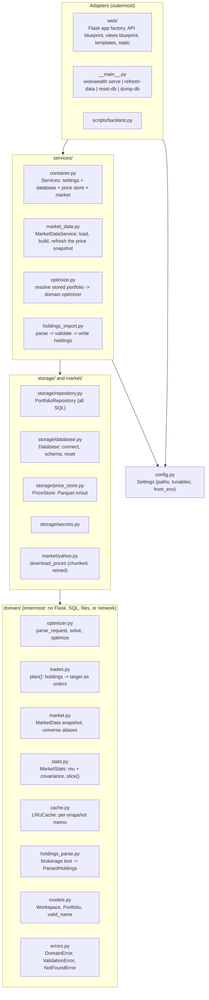
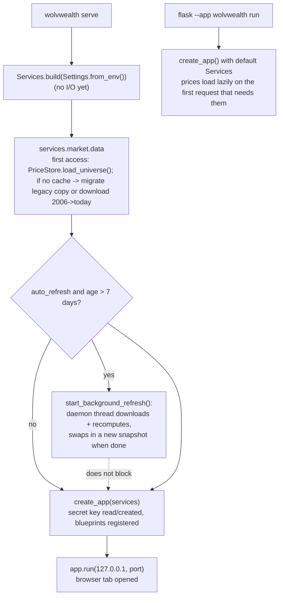
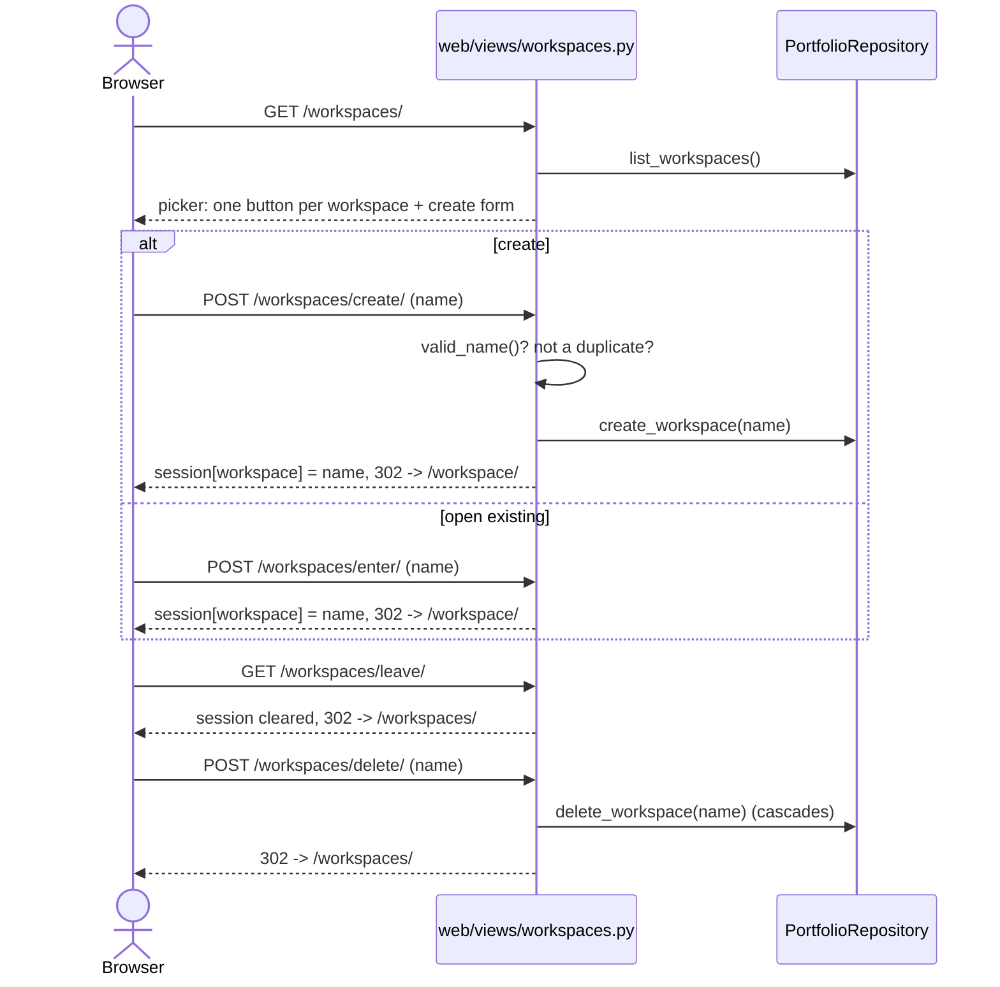
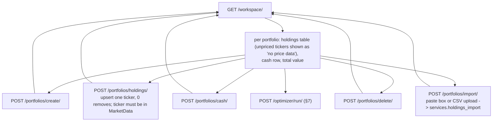
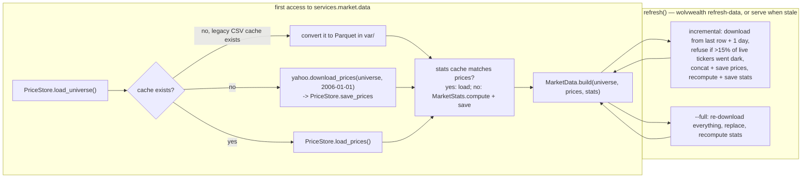
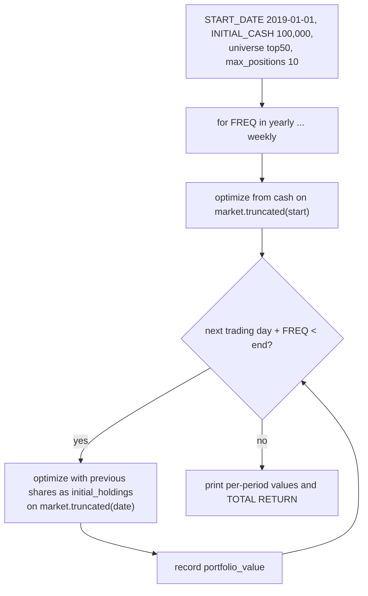
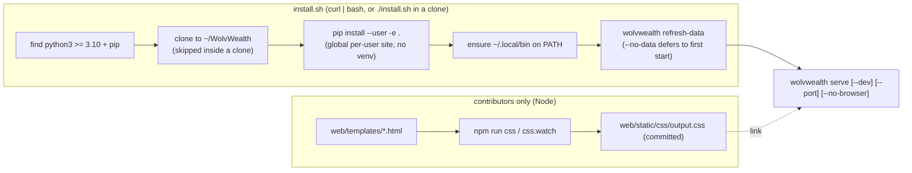
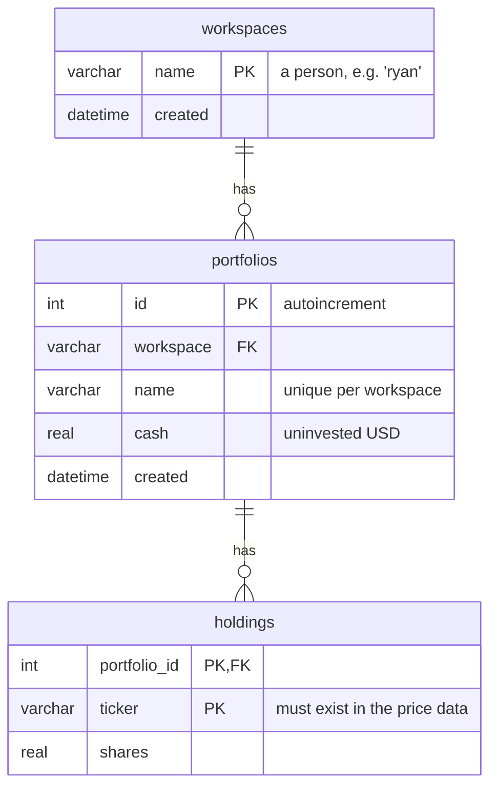

# WolvWealth architecture

This is the map of the code as it is today. It is written for someone who wants to change or extend the app: what the layers are, which direction dependencies point, how a request flows through, and where a new feature plugs in. The project goals and scope are in [README.md](README.md); the JSON contract is in [API.md](API.md).

> **October 2026:** the old online-auth system (accounts, passwords, API keys, paid tiers, admin endpoints) has been removed and replaced with local **workspaces**, and the package has been restructured into layers. If you remember `ApplicationState`, `wolvwealth/api/`, or `wolvwealth/views/`, they are gone; the equivalents are mapped in §3.

## 1. What it is

WolvWealth is a single-process Flask web application for local use. Given a cash amount and/or a set of current stock holdings, it uses [PyPortfolioOpt](https://pyportfolioopt.readthedocs.io/) to compute a maximum-Sharpe-ratio portfolio over a universe of US equities and ETFs, and returns target weights, share counts, and dollar values.

The organizing concept is the **workspace**: one person using this machine (e.g. `ryan`, `my-brother`). Each workspace holds any number of named **portfolios** (e.g. `long-term`, `short-term`), and each portfolio is a cash balance plus share counts per ticker. There are no passwords; anyone at the keyboard can open any workspace. Separation is for organization, not security.

| Piece | Where | Status |
|---|---|---|
| Server-rendered website (landing, workspace picker, workspace page with portfolio CRUD and bulk import, optimizer results) | `wolvwealth/web/views/`, `wolvwealth/web/templates/` | Working end to end |
| JSON API (optimize + trade list, market freshness, list workspaces, bulk-import holdings) | `wolvwealth/web/api/`, contract in `API.md` | Working, no auth required |
| `wolvwealth` command (serve, refresh-data, reset-db, dump-db) and `install.sh` | `wolvwealth/__main__.py`, `install.sh` | Working |
| Market data (ticker list + ~20 years of daily adjusted closes + precomputed return/covariance statistics) | `wolvwealth/data/ticker_universe.csv` (in the package), `var/historical_prices.parquet` and `var/market_stats.parquet` + `.json` (local caches) | Loaded on first access; refreshed by `wolvwealth serve` when stale or by `wolvwealth refresh-data` |
| Walk-forward backtest | `scripts/backtest.py` | Standalone, reuses the domain optimizer |

## 2. The layers and the dependency rule

The package is organized as concentric layers. **A module may import only from its own layer or layers inside it.** `tests/test_architecture.py` parses every file's imports and fails if that rule is broken, so the diagram below is enforced, not aspirational.



What each layer is allowed to know:

| Layer | May import | Must not know about |
|---|---|---|
| `domain/` | numpy, pandas, PyPortfolioOpt, itself | Flask, SQLite, file paths, yfinance, HTTP status codes |
| `storage/`, `market/` | `domain` | Flask, each other |
| `services/` | `domain`, `storage`, `market`, `config` | Flask, `request`, `session`, `g` |
| `web/`, `__main__.py` | everything above | SQL text, solver calls (they call services) |

Why this shape matters for extensibility: a new feature is a new function in `services/` that takes a repository and a `MarketData` and returns plain data, plus whatever thin adapter exposes it (a route, a CLI subcommand). It cannot accidentally reach into Flask internals, the maths cannot accidentally depend on the database, and everything in `domain/` and `services/` is testable without a server. See §12 for the recipe.

Everything resolves paths from `Settings` in `config.py` (absolute, derived from the package location), so the app, the API, and the `wolvwealth` command can be started from **any** working directory.

## 3. Repository layout

```
.
├── wolvwealth/                    The package. Importing it has no side effects.
│   ├── __init__.py                Exports create_app (so `flask --app wolvwealth run` works)
│   ├── __main__.py                The `wolvwealth` command
│   ├── config.py                  Settings dataclass; Settings.from_env() reads WOLVWEALTH_VAR / WOLVWEALTH_NO_AUTO_REFRESH
│   ├── domain/
│   │   ├── errors.py              DomainError(message, details) + ValidationError, NotFoundError
│   │   ├── models.py              Workspace, Portfolio dataclasses; valid_name()
│   │   ├── market.py              MarketData(universe, prices, stats, solutions): price(), value(), top(n), truncated(), stats_for(), expand_universe()
│   │   ├── stats.py               MarketStats(mu, cov): compute() once per refresh, slice() per request
│   │   ├── cache.py               LRUCache: bounded, thread-safe memo for solved weights and metrics
│   │   ├── trades.py              plan(holdings, target, prices) -> buy/sell moves, sells first
│   │   ├── optimizer.py           parse_request() -> OptimizationRequest; solve(); optimize()
│   │   └── holdings_parse.py      parse_holdings(text, universe) -> ParsedHoldings (pasted lines, brokerage CSVs)
│   ├── storage/
│   │   ├── database.py            Database(path): open(), connect() (transaction), ensure_schema(), reset()
│   │   ├── repository.py          PortfolioRepository(connection): every query on the three tables
│   │   ├── price_store.py         PriceStore: prices + stats caches (Parquet) and the ticker list; legacy CSV conversion
│   │   ├── secrets.py             load_or_create_secret_key()
│   │   └── sql/schema.sql, data.sql   Three tables + the `demo` seed
│   ├── market/
│   │   └── yahoo.py               download_prices(tickers, start, end): chunked, paused, retried
│   ├── services/
│   │   ├── container.py           Services.build(settings) wires everything; Services.repository(conn)
│   │   ├── market_data.py         MarketDataService: lazy load / first-run build / refresh / auto_refresh_if_stale
│   │   ├── optimize.py            optimize(payload, market, repo, default_workspace); payload_for_portfolio()
│   │   └── holdings_import.py     import_holdings(...) -> ImportOutcome; resolve_target(); parse_holdings_map()
│   ├── web/
│   │   ├── __init__.py            create_app(services) -> Flask
│   │   ├── context.py             services(), repo(), market(), current_workspace(); per-request connection
│   │   ├── security.py            refuse cross-site requests and non-loopback Host headers (DNS rebinding)
│   │   ├── api/__init__.py        Blueprint "api" at /api: /, /workspaces/, /optimize/, /holdings/import/; DomainError -> JSON
│   │   ├── views/                 Blueprint "views": index, workspaces, portfolios (incl. import), optimizer
│   │   ├── templates/             Jinja, all extending base.html
│   │   └── static/                logo + hero image, util.css, committed Tailwind build (output.css)
│   └── data/ticker_universe.csv   One ticker per line, descending market cap
├── scripts/backtest.py            Standalone walk-forward backtest
├── tests/                         pytest; conftest builds Services on a temp dir with a 4-ticker synthetic market
├── install.sh                     One-command installer (also curl-able)
├── pyproject.toml                 Metadata, four runtime deps, `wolvwealth` entry point, package data, lint settings
├── package.json, tailwind.config.js   Dev-only: `npm run css` rebuilds the committed CSS
├── var/                           Local state, gitignored: wolvwealth.sqlite3, secret_key, historical_prices.parquet, market_stats.parquet/.json
├── API.md                         The JSON contract, written to drop into an agent's context
└── README.md, CONTRIBUTING.md, ARCHITECTURE.md
```


## 4. Process startup



`import wolvwealth` does nothing but define things. `Services.build()` wires collaborators without touching disk. The database file is created from `storage/sql/` the first time a connection is opened; the price cache is created the first time `services.market.data` is read. Only `wolvwealth serve` refreshes prices at startup, and it does so on a daemon thread: a stale refresh is minutes of downloading plus a covariance recompute, and the cached prices are good enough to serve until it lands. Requests read whichever snapshot is current when they start; swapping one in is a single attribute assignment, so no request ever sees a half-built one. `wolvwealth refresh-data` stays synchronous, because there the refresh *is* the command.

## 5. Workflow: workspaces

The session cookie stores exactly one thing: the name of the open workspace. `web/context.py: current_workspace()` reads it and drops it if the workspace has been deleted in the meantime.



Validation errors surface as flashed messages on the picker. Old URLs from the account era redirect: `/login/` and `/register/` go to `/workspaces/`, `/account/` goes to `/workspace/`.

## 6. Workflow: portfolios of a workspace

`GET /workspace/` is the main page: every portfolio in the open workspace with holdings valued at the last cached price, plus forms for every mutation. Every POST redirects back to `/workspace/` and reports problems via flashed messages.



**Bulk import.** The view reads the pasted text or uploaded file and calls `services.holdings_import.import_holdings(repo, market, portfolio, text=..., mode=..., skip_unknown=...)`. That service runs `domain.holdings_parse.parse_holdings()`, which accepts `TICKER, shares` lines with any common separator, or a CSV with a header row where the symbol and share columns are found by name (`symbol`/`ticker`, `quantity`/`shares`/`qty`), so brokerage position exports work unmodified; extra columns, blank lines, `#` comments, and summary rows are ignored, duplicate lots are summed, and a `CASH` row sets cash. Tickers must be in the universe; unknown ones block the import unless skipped. Writes are all-or-nothing: the service raises `ValidationError` with every problem in `details` and nothing is written; the view turns `details` into one flash.

Every repository query is scoped by `(workspace, portfolio_id)`, so a stale or guessed form value cannot touch another workspace's portfolio.

## 7. Workflow: optimize a portfolio (the core feature)

The maths is `domain/optimizer.py`: `parse_request(payload, market)` validates a plain dict into an `OptimizationRequest`, `solve(request, market)` runs PyPortfolioOpt and returns the result dict, `optimize()` does both. The only inputs are the dict and a `MarketData`, so the same code runs from the browser, the API, tests, and the backtest.

```mermaid
sequenceDiagram
    actor B as Browser
    actor C as API client
    participant V as web/views/optimizer.py
    participant A as web/api (POST /api/optimize/)
    participant S as services/optimize.py
    participant R as PortfolioRepository
    participant D as domain/optimizer.py
    participant PF as PyPortfolioOpt

    B->>V: form: portfolio_id, universe alias, constraints
    V->>R: get_portfolio(workspace from session, id)
    V->>S: payload_for_portfolio(portfolio, alias, ...)<br/>(held tickers join the universe so they may be kept)
    V->>S: optimize(payload, market)

    C->>A: JSON body
    A->>S: optimize(body, market, repo, default_workspace=session)
    S->>S: resolve_portfolio_reference(): "portfolio" -> stored cash/holdings<br/>(explicit fields win)
    S->>R: get_portfolio(workspace, name) [NotFoundError if missing]

    S->>D: optimize(payload, market)
    D->>D: parse_request: validate every field (ValidationError)
    D->>D: total = cash + market.value(holdings); 0 -> ValidationError
    D->>D: market.solutions: weights for<br/>(universe, max_weight, min_universal_weight)?
    D->>PF: on a miss only: EfficientFrontier.max_sharpe<br/>over the sliced mu/cov (+ max_weight constraint)
    PF-->>D: weights -> clean, memoize
    D->>D: truncate to max_positions, renormalize, scale by total
    D-->>S: result dict (metrics describe the truncated portfolio)
    S-->>A: 200 JSON
    S-->>V: render results.html
    Note over A,V: ValidationError -> 400 JSON / NotFoundError -> 404 JSON (API)<br/>DomainError -> flashed message on /workspace/ (browser)
```

The `max_positions` step is a post-hoc truncation, not a cardinality constraint in the solver. The reported Sharpe/return/volatility metrics are recomputed from the truncated, renormalized weights, so they describe the portfolio that is actually returned.

### API request schema

All fields are optional. Unknown fields are ignored.

```json
{
  "workspace": "ryan",
  "portfolio": "long-term",
  "initial_cash": 10000,
  "initial_holdings": { "AAPL": 10, "MSFT": 5.5 },
  "universe": ["top50", "TSLA"],
  "constraints": { "max_weight": 0.25, "max_positions": 10, "min_universal_weight": 0.0 },
  "exclude_metrics": false
}
```

| Field | Meaning | Default |
|---|---|---|
| `workspace` + `portfolio` | Load `initial_cash` and `initial_holdings` from this stored portfolio. `workspace` falls back to the browser session's open workspace. Explicit `initial_cash`/`initial_holdings` in the same request win over the stored values | not used |
| `initial_cash` | Cash to invest, USD | 0 (or the stored portfolio's cash) |
| `initial_holdings` | Ticker to share count, valued at the **last row of the price cache** and pooled with cash | `{}` (or the stored holdings) |
| `universe` | Tickers to allocate across. Aliases `top20` ... `top500` expand to the N largest **tradeable** tickers, skipping delisted names. Naming a delisted ticker explicitly is a 400 | top 500 by market cap |
| `constraints.max_weight` | Per-asset cap, 0 to 1 | 1 |
| `constraints.max_positions` | Keep only the N largest weights after solving, then renormalize | unlimited |
| `constraints.min_universal_weight` | Lower bound applied to **every** asset in the universe | 0 |
| `exclude_metrics` | Omit the `metrics` block | false |

Total investment must be greater than zero. The response is `as_of` (the price date every number came from), an `optimized_portfolio` map of ticker to `{shares, value, percent_weight}`, a `trades` list, and a `metrics` block `{portfolio_value, expected_annual_return, annual_volatility, sharpe_ratio, num_assets}`. `exclude_metrics` and `exclude_trades` drop their blocks.

`trades` is `domain/trades.py`: the share deltas from `initial_holdings` to the target, as `{ticker, action, shares, price, value}` with positive share counts and the direction in `action`. Sells lead, each group by descending value, so an agent executing in order frees the cash before spending it; unchanged positions and differences too small to show at four decimals produce no entry. It exists so an agent driving a broker never has to diff two allocations itself, and `price` records which close the plan assumed. The browser results page renders the same list.

**The full contract is `API.md`** — every endpoint, field and error with worked examples, written to be pasted into an agent's context whole. `tests/test_api_contract.py` fails the build if it drifts from the real routes, the fields the parser reads, or the keys the API sends.

### Repeated requests

Agents re-send the same request constantly, so the two costly halves of a solve are memoized on the `MarketData` snapshot (`market.solutions`, a bounded LRU in `domain/cache.py`):

| Memo | Key | Why those fields |
|---|---|---|
| Max-Sharpe weights | `universe`, `max_weight`, `min_universal_weight` | Everything the solver sees. ~90% of a cold request |
| Expected return + volatility | the same, plus `max_positions` | A function of the final weight vector, which those four fields determine |

`initial_cash` and `initial_holdings` are deliberately **not** in either key: they scale the portfolio without changing its shape, so sweeping cash amounts over one universe still costs a single solve. `max_positions` truncates the weights after the solve, so it reuses the solve but gets its own metrics entry.

Because the cache is a field of the snapshot, a price refresh builds a new snapshot and drops every entry with it — there is no expiry logic, and no way to serve a portfolio computed from prices that are no longer current. `truncated()` likewise gives each backtest step its own empty cache. A failed solve is not stored, so an infeasible request keeps reporting its own error.

Measured on synthetic 500×5000 price data, a 200-ticker universe with 500 holdings: **190 ms cold, 0.40 ms repeated** (identical output). The valuation path feeding it was the other half of the work — `MarketData.latest_prices` is a plain ticker-to-price dict built once per snapshot, taking `market.value()` over 500 holdings from 27.6 ms to 0.19 ms.

### Bulk import endpoint

`POST /api/holdings/import/` writes holdings into a stored portfolio and is the agent's way to get a brokerage export into a workspace before calling `/api/optimize/`.

```json
{
  "workspace": "ryan",
  "portfolio": "long-term",
  "create_portfolio": true,
  "mode": "replace",
  "holdings": { "AAPL": 10, "MSFT": 5.5 },
  "cash": 5000,
  "skip_unknown": false
}
```

| Field | Meaning | Default |
|---|---|---|
| `workspace` | Target workspace; falls back to the browser session's open workspace | session |
| `portfolio` | Target portfolio name (required) | |
| `create_portfolio` | Create the portfolio if it does not exist | false |
| `holdings` **or** `csv` | Either a ticker-to-shares object, or the raw text a human would paste into the import box (same parser) | one is required |
| `cash` | Set the portfolio's cash; a `CASH` row in `csv` does the same | unchanged |
| `mode` | `merge` upserts each ticker (0 removes); `replace` drops every existing holding first | `merge` |
| `skip_unknown` | Drop tickers missing from the price cache instead of failing | false |

Success returns `{workspace, portfolio, mode, imported, skipped_unknown, ignored_lines, cash, holdings}` with the portfolio's final state. Any problem is a 400 whose `error.payload` carries `errors` (per-line messages) and `unknown_tickers`, and nothing is written.

### Error shape

Every API error is `{"error": {"message": "...", "status_code": 400|404, "payload": {...}?}}`. `ValidationError` → 400, `NotFoundError` → 404, unparsable JSON → 400. The mapping lives in one place, the `api` blueprint's error handler.

## 8. Workflow: market data

Market data is the ticker list shipped in the package plus two per-machine caches in gitignored `var/`: the price history (`historical_prices.parquet`) and the optimizer statistics derived from it (`market_stats.parquet`, with a `market_stats.json` sidecar recording which prices they were computed from). In memory it is a `MarketData` snapshot (frozen: universe tuple + price DataFrame + `MarketStats`) owned by `MarketDataService`.



Things to know:

- The incremental path never corrects past adjusted closes after splits or dividends; run `--full` occasionally.
- `MarketStats` (mean historical return + exponentially weighted covariance) is the expensive part — ~53 seconds for 500 tickers — and both statistics are separable per column/pair, so they are computed **once per data refresh**, persisted, and sliced per optimize request by `MarketData.stats_for()`. It covers the largest `settings.stats_universe_size` (500) tradeable tickers rather than the whole list: `exp_cov` loops over every pair of columns in Python, so all 1982 tickers take ~17 minutes against ~53 seconds for 500, and every alias stops at `top500` anyway. A universe reaching past that falls back to computing its own statistics. The `.json` sidecar (last price date, row count, ticker count) is written after the matrix and checked against the loaded prices, so a stale or half-written stats cache is rebuilt instead of silently served. Backtests call `truncated()`, which drops the stats (they describe the full history; reading them would be lookahead) and falls back to on-the-fly computation.
- Yahoo rate-limits bulk downloads and a rate-limited ticker comes back all-NaN. `market/yahoo.py` fetches in chunks of 100 with pauses and retries the all-NaN stragglers with backoff. The download function is injectable (`MarketDataService(downloader=...)`), which is how tests avoid the network.
- A delisted ticker ends in NaN. `MarketData.has_price()` is false for it; the workspace page shows "no price data" instead of failing, and the optimizer refuses it in `initial_holdings`.
- To change the universe, edit `wolvwealth/data/ticker_universe.csv` (descending market cap) and run `wolvwealth refresh-data --full`. The old live-market-cap sorting helpers were removed.
- `yfinance` is `>=1.7`. Yahoo changes its endpoints often; if downloads start failing wholesale, bump yfinance first.

### Dead tickers, and why the ticker list is not pruned

A full download of the 1982-ticker universe comes back with a few hundred columns that are entirely empty — 406 in the run this was measured on. It is tempting to read that as "406 companies have delisted, let's delete them from `ticker_universe.csv`". **Do not.** Yahoo returns the same nothing in two very different cases:

- **Genuinely gone.** Acquired, taken private, or renamed (`PXD` into Exxon, `SPLK` into Cisco, `WBA` taken private). Yahoo serves nothing for the symbol *at all*, not even the history it had while trading.
- **Throttled.** The request was simply refused, and the data is there if you ask again.

Nothing in the response distinguishes them. Sampling 30 of those 406 against Yahoo one at a time, **22 were genuinely gone and 8 (`WYNN`, `CAKE`, `TLRY`, `AMC`, `LUMN`, `UHS`, `XRAY`, `GEO`) were live companies whose download had failed** — and re-requesting 60 of them recovered 11. Pruning on that evidence would permanently delete roughly a hundred live companies from the investable universe because one download got rate-limited.

So the list stays as-is and the app handles the problem dynamically instead: `MarketData.tradeable` recomputes which tickers have a current price on every snapshot, `download_prices` retries stragglers in shrinking batches, and `MarketDataService` logs how many never arrived rather than passing off a short universe as the whole market. A ticker that was only throttled reappears by itself on the next `--full` refresh.

One consequence worth knowing when reading backtest output: because Yahoo will not serve history for a delisted symbol, the cache contains **only companies that survived to the download date**. Walk-forward results are therefore survivorship-biased and flatter than reality. `truncated()` does the right thing with the data it has — a company whose prices stop in 2024 is correctly tradeable at a 2019 backtest date — but companies that died before the download are missing entirely.

## 9. Workflow: backtest (`scripts/backtest.py`)

A standalone script, `python3 scripts/backtest.py`. It builds `Services`, takes the `MarketData`, and walks forward in time calling `domain.optimizer.optimize()` on `market.truncated(date)`, so every solve only sees data available at that time (no lookahead) and nothing global is mutated.

Read the output knowing it is **survivorship-biased**: the price cache can only contain companies still listed when it was downloaded (see "Dead tickers" in §8), so the backtest never picks a company that failed. Returns come out flatter than a real portfolio run from the same start date would have been.



## 10. Workflow: install, run, and the frontend build



- The install is **editable** so the clone is the install, but everything the app needs at runtime (templates, static, SQL, ticker list) now lives inside the package and is declared as package data, so a non-editable install would also work. `var/` defaults to the repo root; `WOLVWEALTH_VAR` relocates it.
- `serve` always binds 127.0.0.1. There is no prod mode: this app has no auth and is localhost-only by design.
- **Node is not a runtime dependency.** The Tailwind output is committed; anyone who edits classes in a template runs `npm run css` and commits the result. There is no JavaScript build.
- Containers were considered and rejected: the point of the global install is that `import wolvwealth` works for an agent spawned anywhere on the device, which a container would hide behind a port.

## 11. Data model



Foreign keys cascade on delete and `PRAGMA foreign_keys = ON` is set per connection in `Database.open()`. The domain sees these as `Workspace` and `Portfolio` dataclasses (`domain/models.py`); only `storage/repository.py` knows the table names.

## 12. Adding a bolt-on

The layering exists so that a new capability is a small, local change. The recipe:

1. **Domain first, if there is new logic.** Pure functions or dataclasses in `domain/`. Inputs are plain data and a `MarketData`; failures raise `ValidationError`/`NotFoundError`. No imports from outer layers. Unit-test them with the `market` fixture, no app needed.
2. **A use case in `services/`.** One module, one or a few functions taking `(repo, market, ...)` and returning plain data or a small result dataclass. If it needs new persistence, add methods to `PortfolioRepository` (and the schema in `storage/sql/`) rather than writing SQL in the service. If it needs a new external source, add a module under `market/` with an injectable function the way `yahoo.download_prices` is.
3. **An adapter.** For the API, a route on the `api` blueprint that reads JSON, calls the service, and `jsonify`s the result; errors are already handled. For the browser, a view module registered in `web/views/__init__.py` plus a template extending `base.html`. For the terminal, a subcommand in `__main__.py` receiving `Services`. Adapters should be a dozen lines: parse, call, render.
4. **Tests ship with it.** `conftest.py` gives you `services` (temp dir, synthetic market), `client`, `workspace_client`, `repo`, `market`. `tests/test_architecture.py` will tell you if you imported across layers.

Examples of bolt-ons that fit this shape without touching existing modules: a `trades` service that diffs an optimization result against a portfolio's holdings into buy/sell share deltas; an alternative `PriceStore` (e.g. SQLite-backed) swapped in via `Services.build`; a rebalancing-schedule command; a second price provider under `market/`.

## 13. Performance, and what is known to be imperfect

An optimize request used to recompute the covariance of up to 500 tickers, parse a CSV at startup, and block `serve` for minutes on a stale cache. All of that is gone, because agents re-send the same request constantly and each round trip is someone's money:

| Was | Now |
|---|---|
| `mean_historical_return` + `exp_cov` per request | Once per data refresh, persisted in `var/market_stats.parquet`, sliced per request (§8) |
| CSV price cache parsed at startup | Parquet, with old CSV caches converted on first load (§8) |
| Stale refresh blocked `serve` for minutes | Daemon thread, serving cached prices until it lands; writes are atomic (§4) |
| Identical requests re-solved | Memoized on the price snapshot, keyed on what reaches the solver (§7) |

On the real 1982-ticker history, a 200-ticker request with 500 holdings is ~190 ms cold and 0.40 ms repeated; over HTTP, 348 ms then 6 ms.

### The default request used to fail on real data

Checked against the real 1982-ticker history (2006 to 2026), not the synthetic benchmark. The default universe size of 500 was never the problem; two independent faults were, and either one alone broke every request that did not name a universe:

1. **The solver.** cvxpy defaulted to OSQP, a first-order method that hits its iteration limit and fails outright past roughly 400 tickers — 400 and 500 both failed on real prices, and 300 took 33 s on synthetic data. `SOLVER = "CLARABEL"` (interior-point, already a required cvxpy dependency) solves every size in a fraction of the time and agrees with OSQP to ~1e-5, far below `WEIGHT_THRESHOLD`, so output is unchanged wherever OSQP converged at all.
2. **Tickers with no current price.** 19 of the real top 500 (`PXD`, `SPLK`, `ANSS`, `WBD`, …) are in the ticker list but have no price at the end of the history — some genuinely delisted, some only throttled during the download, and the data cannot tell you which (see "Dead tickers" in §8). Their exponentially weighted covariance with everything else is NaN — exactly the 18,639 NaN cells observed — which made cvxpy reject the whole problem, and one held in a portfolio raised an uncaught `KeyError` out of `market.value()`, a 500 from an API whose contract promises JSON errors. `MarketData.tradeable` now filters them out of `top(n)` and the aliases, and naming one explicitly in `universe` or `initial_holdings` is a 400. The fix is the same either way: a ticker with no current price cannot be valued, so it must not be allocated to.

On real data the default request now solves in 0.27 s cold and 0.18 ms repeated; over HTTP, 348 ms then 6 ms.

**Agent-readiness** (after that)

5. A `trades` block in the optimize response (buy/sell share deltas vs. `initial_holdings`) so an agent can feed a broker MCP directly.
6. The API contract in §7 should be published in a form that drops into an agent's context without reading the code.
