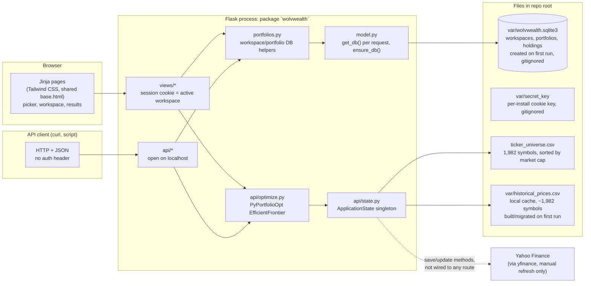
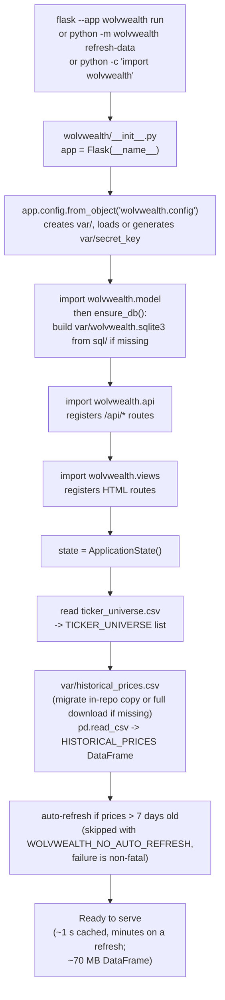
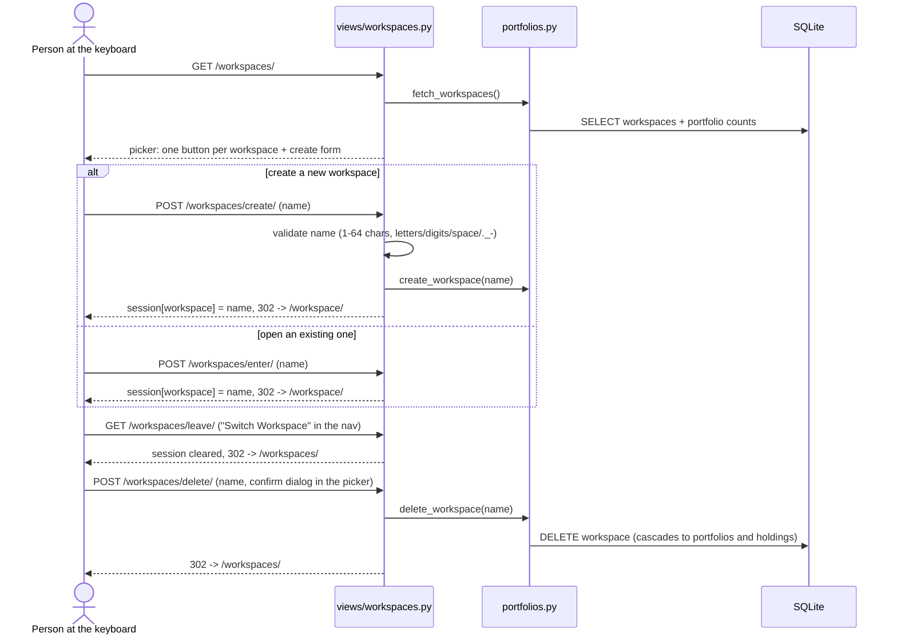
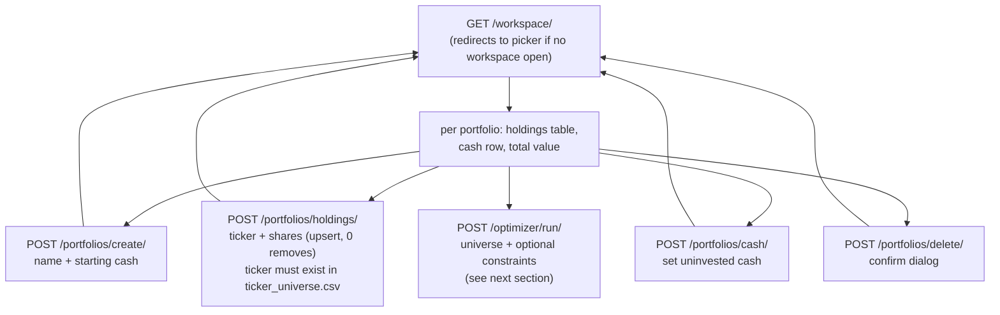
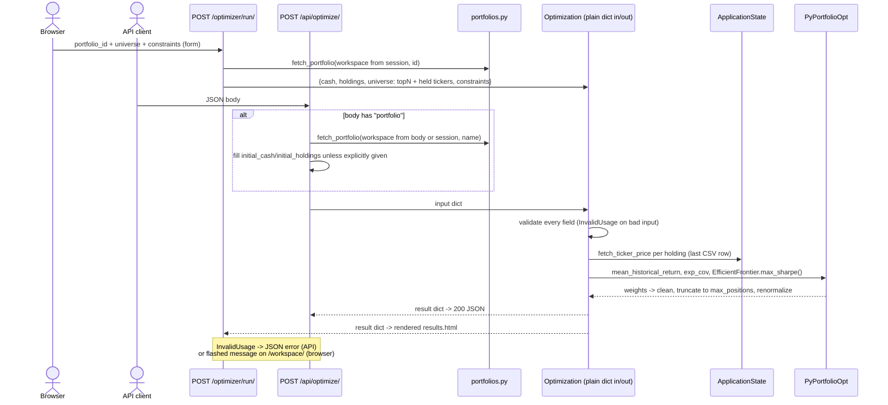
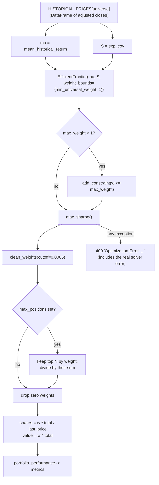
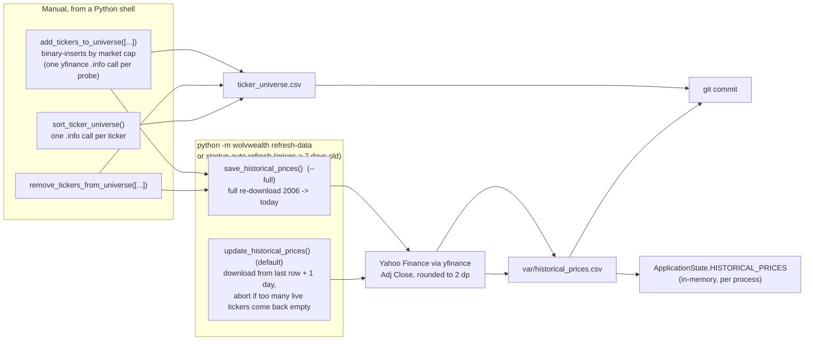
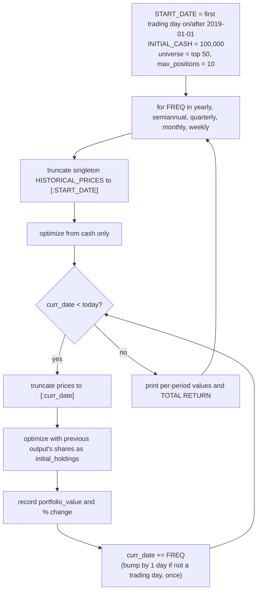
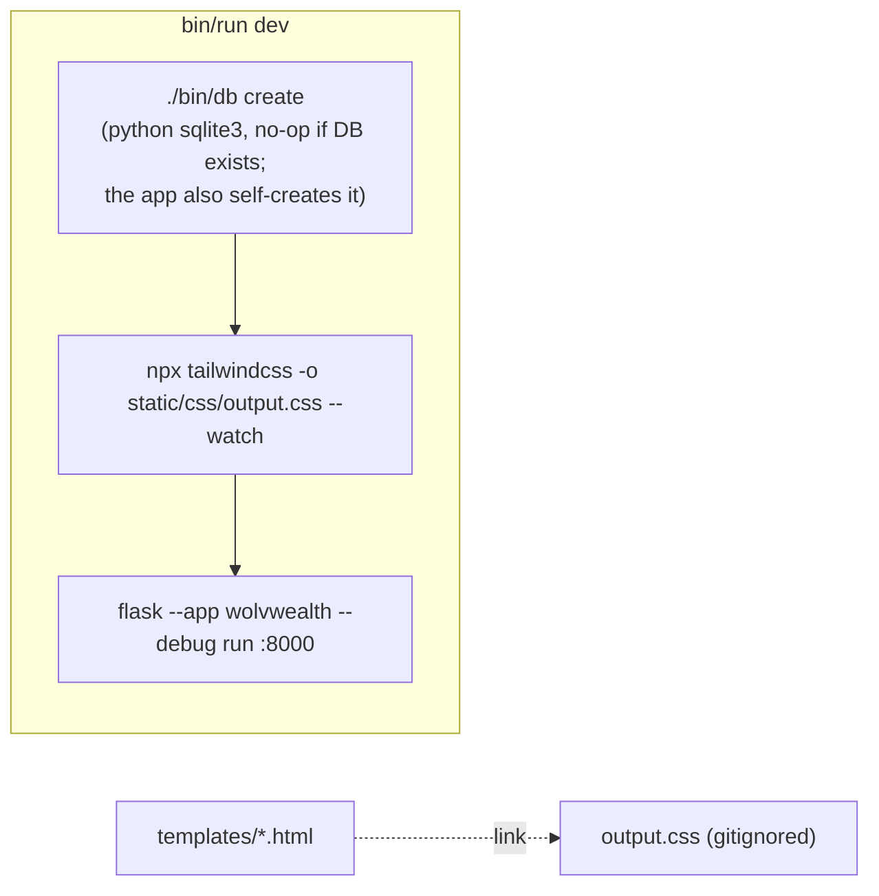
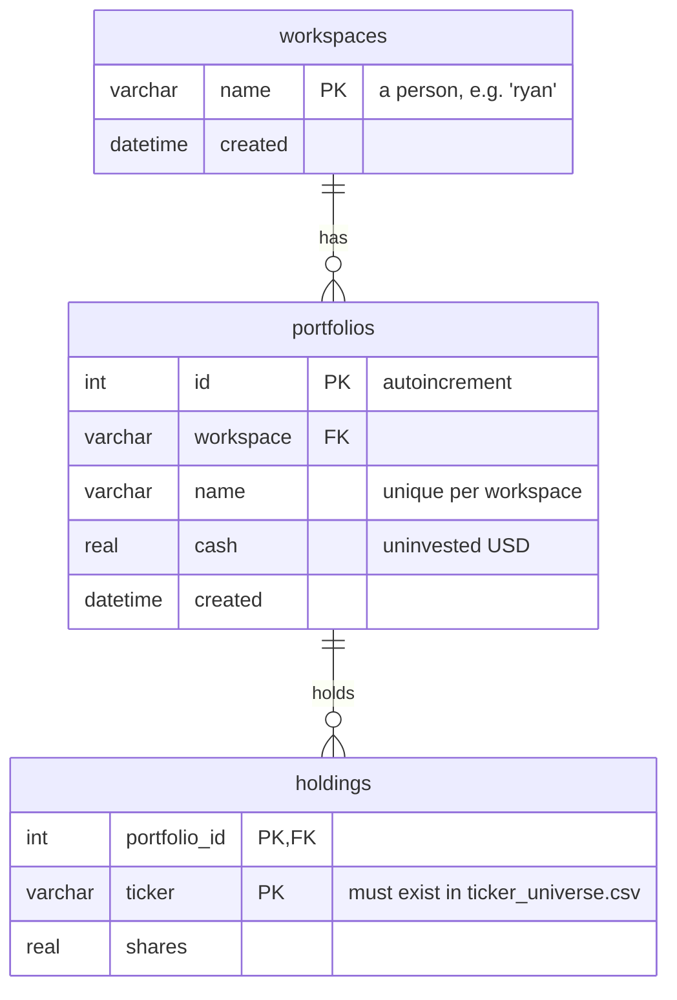

# WolvWealth Architecture

This document is an eagle-eye view of the codebase **as it exists today**. It describes what the app actually does, not what we want it to do. See the README for the goal, MIGRATION.md for the plan to get there, and CONTRIBUTING.md for how to work on it.

Facts in here were verified by reading the code and by running the app with the Flask test client. Where something is broken or surprising, it is called out rather than smoothed over.

> **October 2026:** the old online-auth system (accounts, passwords, API keys, paid tiers, admin endpoints) has been removed and replaced with local **workspaces**. If you remember the login/register/API-key flow, it is gone.

## 1. What the app is

WolvWealth is a single-process Flask web application for local use. Given a cash amount and/or a set of current stock holdings, it uses [PyPortfolioOpt](https://pyportfolioopt.readthedocs.io/) to compute a maximum-Sharpe-ratio portfolio over a universe of US equities and ETFs, and returns target weights, share counts, and dollar values.

The organizing concept is the **workspace**: one person using this machine (e.g. `ryan`, `my-brother`). Each workspace holds any number of named **portfolios** (e.g. `long-term`, `short-term`, `lottery-tickets`), and each portfolio is a cash balance plus share counts per ticker. There are no passwords — anyone at the keyboard can open any workspace. Separation is for organization, not security.

Three things live in the same process:

| Piece | Where | State |
|---|---|---|
| Server-rendered website (landing, workspace picker, workspace page with portfolio CRUD, optimizer results) | `wolvwealth/views/`, `wolvwealth/templates/` | Working end to end |
| JSON API (optimize, list workspaces) | `wolvwealth/api/` | Working, no auth required |
| Market data cache (tickers + ~20 years of daily adjusted closes) | `ticker_universe.csv` (in repo), `var/historical_prices.csv` (local cache), loaded by `wolvwealth/api/state.py` | Loaded into memory at import; auto-refreshed on startup when older than 7 days, or on demand via `python -m wolvwealth refresh-data` |

There is also a standalone walk-forward backtest script, `scripts/backtest.py`, that reuses the app's data loader and `Optimization` class but is not reachable from the web app. The optimizer UI is server-rendered from the workspace page.

## 2. System overview



Everything is file-local to the repository root, but all paths (CSVs, `var/`, `sql/`) are resolved as absolute paths from the package location in `config.py`, so the app, the API, and `python -m wolvwealth` can be started from **any** working directory.

## 3. Repository layout

```
.
├── wolvwealth/                Flask package (the app)
│   ├── __init__.py            Creates `app`, loads config, ensures DB exists, imports api + views, builds ApplicationState
│   ├── config.py              Per-install secret key (var/secret_key), DB path
│   ├── model.py               SQLite connection helper + ensure_db() (builds DB from sql/ on first run)
│   ├── portfolios.py          Workspace/portfolio DB helpers shared by views and API
│   ├── api/
│   │   ├── __init__.py        /api/ usage endpoint, /api/workspaces/
│   │   ├── state.py           ApplicationState: loads/saves CSVs, yfinance helpers
│   │   ├── optimize.py        Optimization class (framework-free) + POST /api/optimize/
│   │   └── api_exceptions.py  InvalidUsage -> JSON error responses
│   ├── views/                 HTML routes
│   │   ├── index.py           Landing page
│   │   ├── workspaces.py      Picker, create/enter/leave/delete, current_workspace(), legacy redirects
│   │   ├── portfolios.py      Workspace page: portfolio + holdings + cash CRUD
│   │   └── optimizer.py       POST /optimizer/run/ (server-rendered results)
│   ├── templates/             Jinja templates, one per page, all extending base.html
│   │   ├── index.html         Landing
│   │   ├── workspaces.html    Workspace picker (replaces login/register)
│   │   ├── workspace.html     Portfolios of the active workspace (replaces account)
│   │   ├── results.html       Optimization results table + metrics
│   │   ├── base.html          Shared layout: head, nav header, footer (all pages extend it)
│   │   └── _flashes.html      Flashed-message partial
│   └── static/                Images, util.css, and the Tailwind build output (output.css)
├── sql/schema.sql             Three tables: workspaces, portfolios, holdings
├── sql/data.sql               Seed: a `demo` workspace with one `starter` portfolio
├── var/                       Local state, gitignored: wolvwealth.sqlite3, secret_key
├── ticker_universe.csv        One ticker per line, descending market cap
│                              (price history lives in var/historical_prices.csv, 40 MB, not in git)
├── scripts/backtest.py        Standalone walk-forward backtest (reuses the app's Optimization)
├── bin/setup | bin/db | bin/run   Dev scripts (bin/db now uses Python's sqlite3, no CLI needed)
├── pyproject.toml             Package metadata, dependencies (the single source of truth), black/pylint settings
├── package.json               Node deps: Tailwind only
├── tailwind.config.js
└── README.md, CONTRIBUTING.md, ARCHITECTURE.md, MIGRATION.md
```

## 4. Process startup

Importing the `wolvwealth` package has side effects. Routes are registered by decorators that run at import time, and the market data is loaded eagerly.



Two per-install files are generated automatically under `var/` (gitignored): the SQLite database and the session-cookie signing key. A fresh clone therefore works with no setup beyond installing dependencies, and no secrets ship with the repo.

`ApplicationState` is a singleton. Any later `ApplicationState()` call anywhere in the process returns the same loaded object. `scripts/backtest.py` relies on this to swap in a truncated price history.

## 5. Workflow: workspaces

The session cookie stores exactly one thing: the name of the open workspace. `current_workspace()` in `views/workspaces.py` reads it and drops it if the workspace has been deleted in the meantime.



There is no authentication anywhere. Validation errors (bad name, duplicate workspace) surface as flashed messages on the picker. Old URLs from the account era redirect: `/login/` and `/register/` go to `/workspaces/`, `/account/` goes to `/workspace/`.

## 6. Workflow: portfolios of a workspace

`GET /workspace/` is the main page of the app: every portfolio in the open workspace with its holdings valued at the last cached price, plus forms for all mutations. Every POST redirects back to `/workspace/` and reports problems via flashed messages.



Every mutation query is scoped by `(workspace, portfolio_id)` in `portfolios.py`, so a stale or guessed form value cannot touch another workspace's portfolio — again for tidiness, not security, since anyone can just open the other workspace.

## 7. Workflow: optimize a portfolio (the core feature)

The optimization engine is `Optimization` in `api/optimize.py`. It is deliberately framework-free: it takes a plain input dict and exposes a plain result dict, and two callers wrap it.

**From the browser:** each portfolio card has an Optimize form (universe size, optional max positions, optional max weight). The view builds the input from the stored portfolio — held tickers are added to the universe so the optimizer is allowed to keep them — and renders `results.html`.

**From a script:** `POST /api/optimize/` with JSON. No auth header. The body either spells out `initial_cash`/`initial_holdings` or references a stored portfolio by name.



### API request schema

All fields are optional. Unknown fields are ignored.

```json
{
  "workspace": "ryan",
  "portfolio": "long-term",
  "initial_cash": 10000,
  "initial_holdings": { "AAPL": 10, "MSFT": 5.5 },
  "universe": ["top50", "TSLA"],
  "constraints": {
    "max_weight": 0.25,
    "max_positions": 10,
    "min_universal_weight": 0.0
  },
  "exclude_metrics": false
}
```

| Field | Meaning | Default |
|---|---|---|
| `workspace` + `portfolio` | Load `initial_cash` and `initial_holdings` from this stored portfolio. `workspace` falls back to the browser session's open workspace. Explicit `initial_cash`/`initial_holdings` in the same request win over the stored values | not used |
| `initial_cash` | Cash to invest, USD | 0 (or the stored portfolio's cash) |
| `initial_holdings` | Ticker to share count. Valued at the **last row of the price CSV** and pooled with cash | `{}` (or the stored holdings) |
| `universe` | Tickers to allocate across. Aliases `top20` ... `top500` expand to the first N tickers of `ticker_universe.csv` | top 500 by market cap |
| `constraints.max_weight` | Per-asset cap, 0 to 1 | 1 |
| `constraints.max_positions` | Keep only the N largest weights after solving, then renormalize | unlimited |
| `constraints.min_universal_weight` | Lower bound applied to **every** asset in the universe | 0 |
| `exclude_metrics` | Omit the `metrics` block | false |

Total investment must be greater than zero, so you need cash or holdings or both. The response shape is unchanged from the original API: an `optimized_portfolio` map of ticker to `{shares, value, percent_weight}` plus a `metrics` block.

### Semantics that matter for "optimize my own portfolio"

- **Holdings are liquidated, not held.** `initial_holdings` is converted to a dollar figure and the entire amount is reallocated across `universe`. The optimizer does not model trades or taxes. The browser flow at least adds your held tickers to the universe so keeping them is possible; the raw API does not unless you do it yourself. A held ticker absent from the result means "sell it all" — the results page says so.
- **Prices are cached, not live.** Share counts and holding values use the last row of `var/historical_prices.csv`; no quote is fetched during a request. The startup auto-refresh keeps the cache within about a week of today. Both the workspace and results pages display the price date.
- **Expected returns are naive.** Mean historical return over the full 2006-to-present window and an exponentially weighted covariance. Any asset with a short history will have NaNs in its column, which PyPortfolioOpt handles poorly; the solver's real error message is included in the 400 response.

### The optimization pipeline in detail



The `max_positions` step is a post-hoc truncation, not a cardinality constraint in the solver. The reported Sharpe/return/volatility metrics are recomputed from the truncated, renormalized weights, so they describe the portfolio that is actually returned.

## 8. Workflow: market data

Market data is the committed `ticker_universe.csv` plus a per-machine price cache in gitignored `var/historical_prices.csv`, created on first run (migrated from the old in-repo copy if present, otherwise downloaded in full). Price refresh is scripted and automatic: `python -m wolvwealth refresh-data [--full]` from any directory, plus a startup auto-refresh in `wolvwealth/__init__.py` that runs the incremental path whenever the newest cached row is older than `AUTO_REFRESH_MAX_AGE_DAYS` (7) days. The auto-refresh is skipped when `WOLVWEALTH_NO_AUTO_REFRESH` is set and never fails startup — on error the app keeps serving cached prices. Universe editing (add/remove/sort tickers) is still a manual Python-shell task.



Things to know:

- `update_historical_prices()` (the default and the auto-refresh path) appends to the in-memory DataFrame and rewrites the CSV. It does not re-download existing rows, so it is fast, but it never corrects past adjusted closes after splits or dividends. `save_historical_prices()` (`--full`) does a complete refresh and is the correct one to run before committing data.
- Yahoo rate-limits bulk downloads: a rate-limited ticker silently comes back as an all-NaN column, which would poison the optimizer. The downloader therefore fetches in chunks of 100 with pauses, retries all-NaN tickers with backoff, and the incremental path **refuses to write the CSV** if more than 15% of previously live tickers return no data.
- `add_tickers_to_universe` makes live `yf.Ticker(x).info` calls inside a binary search, which is slow and rate-limited. It then triggers a full price re-download.
- The price CSV is 40 MB and grows with every refresh, but it lives in gitignored `var/`, so refreshes never touch git.
- `yfinance` is `>=1.7`. Yahoo changes its endpoints often; if downloads start failing wholesale, bump yfinance first.

## 9. Workflow: backtest (`scripts/backtest.py`)

A standalone script, run as `python3 scripts/backtest.py`. It is not imported by the app. It reuses the app's `Optimization` class and walks forward in time, truncating the price history before each solve.



Caveats: it is lookahead-free only because the DataFrame is truncated before each solve, it mutates the global singleton in place (so never import it inside the running web app), and `get_next_date` only tries one extra day when it lands on a non-trading day, so it can land on a missing index and raise.

## 10. Workflow: frontend build and dev scripts



- `bin/db` now uses Python's built-in `sqlite3` module, so the `sqlite3` CLI is no longer required. `create`/`destroy`/`reset`/`dump` operate on workspaces, portfolios, and holdings.
- `bin/run` only has a `dev` mode and binds to localhost. The old `prod` mode (debug server under `sudo` on port 80) and the gunicorn config are gone: this app has no auth and is localhost-only by design.
- There is no JavaScript build beyond Tailwind. The optimizer UI is the server-rendered form on `/workspace/` plus `results.html`.

## 11. Data model



Foreign keys cascade on delete (delete a workspace and its portfolios and holdings go with it) and `PRAGMA foreign_keys = ON` is set per connection in `model.py`. Names are validated in `portfolios.py` (1-64 chars: letters, digits, space, `.`, `_`, `-`). The database is created from `sql/schema.sql` + `sql/data.sql` on first run and lives in gitignored `var/`, so each machine has its own private workspaces.

## 12. Route reference

| Method | Path | Needs open workspace | Module | Notes |
|---|---|---|---|---|
| GET | `/` | no | views/index.py | Landing page; nav adapts to open workspace |
| GET | `/workspaces/` | no | views/workspaces.py | Picker: list, enter, create, delete |
| POST | `/workspaces/create/` | no | views/workspaces.py | Validates name, opens the new workspace |
| POST | `/workspaces/enter/` | no | views/workspaces.py | Sets session |
| GET/POST | `/workspaces/leave/` | no | views/workspaces.py | Clears session ("Switch Workspace") |
| POST | `/workspaces/delete/` | no | views/workspaces.py | Deletes any workspace by name (confirm dialog in UI) |
| GET | `/workspace/` | yes -> redirects to picker | views/portfolios.py | Portfolios with priced holdings, all forms |
| POST | `/portfolios/create/` | yes | views/portfolios.py | Name + starting cash |
| POST | `/portfolios/delete/` | yes | views/portfolios.py | Scoped to open workspace |
| POST | `/portfolios/cash/` | yes | views/portfolios.py | Set uninvested cash |
| POST | `/portfolios/holdings/` | yes | views/portfolios.py | Upsert one ticker (0 shares removes); ticker must be in the universe |
| POST | `/optimizer/run/` | yes | views/optimizer.py | Optimize a saved portfolio, render results.html |
| GET/POST | `/api/` | no | api/__init__.py | Endpoint listing |
| GET | `/api/workspaces/` | no | api/__init__.py | All workspaces, portfolios, holdings as JSON |
| POST | `/api/optimize/` | no (optional session fallback for `workspace`) | api/optimize.py | The core feature; accepts stored-portfolio reference or explicit fields |
| GET | `/login/`, `/register/` | no | views/workspaces.py | 302 to `/workspaces/` (legacy bookmarks) |
| GET | `/account/` | no | views/workspaces.py | 302 to `/workspace/` (legacy bookmark) |

Everything removed with the auth system now 404s: `/accounts/*`, `/api/account`, `/api/admin/*`, `/api/db/*`.

**Trust model:** none. The app assumes it is bound to localhost on a machine whose users trust each other. Workspaces separate data for convenience; any workspace can be opened, modified, or deleted by whoever is at the keyboard, and the JSON API can read and optimize any workspace's portfolios. Do not expose this to a network you don't trust.

## 13. Known gaps between here and the goal

The goal (README): each of us runs this locally against our own portfolios, with the local API usable as a tool surface for AI agents (which then place trades via broker MCPs like Robinhood's). The ordered plan is in MIGRATION.md; the underlying issues, roughly by how much they block the goal:

**Correctness**

1. ~~Metrics computed before `max_positions` truncation~~ — fixed; metrics now describe the returned portfolio (§7).
2. ~~Real optimization exception swallowed~~ — fixed; the solver's error text is part of the 400 message.
3. ~~`backtest.py` duplicates the optimization logic~~ — fixed; `scripts/backtest.py` imports and reuses `Optimization`.

**Operability for a local, single-user setup**

4. ~~No refresh command / 40 MB CSV committed to git~~ — done; `python -m wolvwealth refresh-data` + startup auto-refresh, and the price cache lives in gitignored `var/` (migrated or downloaded on first run).
5. ~~CSV paths are relative to the working directory~~ — done; all paths resolve from the package location, so everything runs from any directory.
6. No import path for holdings: entering a 30-position portfolio one form row at a time is tedious. A CSV upload or paste box would fix it.

**Hygiene**

7. ~~No tests~~ — `tests/` covers the optimizer core, the API contract, and the workspace/portfolio flows (temp DB + synthetic market fixtures). Every change from now on ships with tests.
8. ~~`pyproject.toml` dependencies disagree with `requirements.txt`~~ — done; `requirements.txt` is deleted and `pyproject.toml` is the single source of truth (four runtime deps, dev tools behind a `dev` extra).
9. ~~Each Jinja template carries its own copy of the header, nav, footer, and scroll script~~ — fixed; all pages extend `templates/base.html` and include `_flashes.html`.
10. ~~The React optimizer page is an empty shell~~ — deleted, along with webpack and all unused frontend dependencies; `/optimizer/` now 404s.
11. Timezones: `created` timestamps are stored in UTC and now displayed nowhere, so the old hardcoded UTC-5 conversion is gone — but if we surface timestamps again, do it properly.
